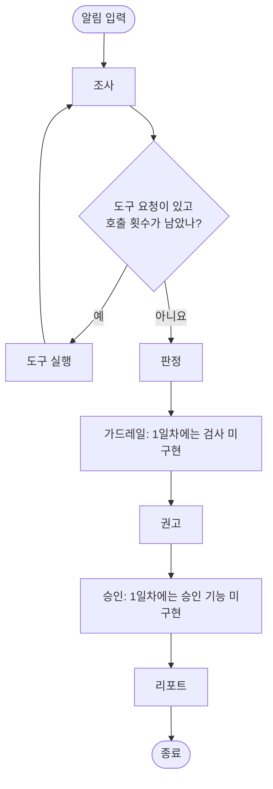

# 아키텍처

> 1일차 4-1 설계 초안. 제공된 `TriageState`, 노드와 그래프의 구현 지침을 바탕으로 작성했다. 아래 그림은 4-2에서 구현할 목표이며, 아직 실행 결과가 아니다.

## 1. 에이전트 설계도

1일차에는 가짜 알림, 가짜 도구(`mocks.py`), 가짜 LLM을 이용해 조사부터 리포트까지의 흐름을 확인한다. 가드레일과 승인 노드는 그래프에 위치만 연결하며, 실제 검사와 사람 승인 기능은 아직 구현하지 않는다.

1일차 확인 경로: `조사 → 도구 → 조사 → 판정 → 권고 → 리포트`. 가드레일과 승인 노드가 경로에 포함되더라도 실제 검증이나 승인 대기는 아직 수행하지 않는다. 그래프를 구현한 뒤 `python -m soc.agent.graph`의 출력과 이 그림을 비교한다.

### 상태 (TriageState)

노드는 공유 상태를 읽고 필요한 항목을 갱신한다. 상세 형식은 `src/soc/agent/state.py`에 정의되어 있다.

| 상태 | 내용 |
| --- | --- |
| `alert` | 조사할 알림과 호스트, PID 등 |
| `messages` | AI의 조사 대화, 도구 호출과 결과 |
| `seen_event_ids` | 도구 결과에서 확인한 이벤트 ID |
| `tool_rounds` | 도구 실행 횟수 |
| `verdict` | 판정, 신뢰도, 기법, 근거 ID, 판정 이유 |
| `guardrail`, `guardrail_log`, `guardrail_retries` | 판정 검사 결과, 검사 이력과 재시도 횟수 |
| `playbook` | 검색한 대응 문서 조각과 출처 |
| `recommendation` | 추천 조치와 이유 |
| `approval` | 승인 필요 여부와 결정 |
| `report` | 최종 리포트 |
| `trace`, `usage` | 지나온 노드와 모델 사용량 |

### 노드와 상태

| 노드 | 하는 일 | 읽는 상태 | 쓰는 상태 | 쓰는 도구 | 운전 |
| --- | --- | --- | --- | --- | --- |
| 조사 | 알림과 대화를 보고 조사 도구 호출 여부를 결정한다. | `alert`, `messages` | `messages`, `trace`, `usage` | 가짜 LLM, 조사 도구 호출 요청 | 📘 문서 담당 |
| 도구 실행 | 요청된 조사 도구를 실행하고 반환된 이벤트 ID를 모은다. | `messages`, `tool_rounds` | `messages`, `seen_event_ids`, `tool_rounds`, `trace` | 가짜 조사 도구 3개 | 👥 함께 확인 |
| 판정 | 조사 결과를 바탕으로 판정과 근거를 작성한다. | `messages` | `verdict`, `trace`, `usage` | 가짜 LLM | 👥 함께 확인 |
| 가드레일 | 판정 검사의 위치. 1일차에는 실제 검사 함수가 미구현이다. | `verdict`, `seen_event_ids`, `alert` | `guardrail`, `guardrail_log`, `trace` 등 | 검사 함수 (미구현) | 👥 흐름 확인 |
| 권고 | 판정에 관련된 문서 조각을 찾고 대응 권고를 만든다. | `alert`, `verdict` | `playbook`, `recommendation`, `trace`, `usage` | 가짜 `search_playbook`, 가짜 LLM | 🔍 기록 담당 |
| 승인 | 승인 기능의 위치. 1일차에는 실제 승인을 기다리지 않는다. | `recommendation` | `approval`, `trace` | — | 👥 흐름 확인 |
| 리포트 | 알림, 판정, 근거, 권고와 승인 상태를 모은다. | `alert`, `verdict`, `guardrail`, `playbook`, `recommendation`, `approval`, `usage`, `tool_rounds`, `trace` | `report`, `trace` | — | 👥 함께 확인 |

## 2. 갈림길

- **도구를 더 호출할까?** 조사 결과에 도구 호출 요청이 있고 `tool_rounds`가 `max_tool_rounds`보다 작으면 도구를 실행한 뒤 다시 조사한다. 요청이 없거나 상한에 도달하면 판정으로 간다. 현재 설정의 기본 상한은 6회다.
- **가드레일이 실패하면?** 제공된 설정은 기본적으로 한 번 재조사하는 방향이다. 다만 실제 근거 검사 함수는 1일차에 구현하지 않으므로, 이 실패 경로는 설계상 위치로만 남긴다.
- **위험한 조치가 있으면?** 승인 노드의 위치는 그래프에 포함한다. 현재 노드는 승인 필요 여부만 표시하며, 실제로 멈춰 사람의 승인을 받지는 않는다.

## 3. 배포 구성도 (2일차부터)
<!-- 01b 문서 2장의 그림을 실제 리소스(Deployment, StatefulSet, Job, Service, Ingress, Secret, ConfigMap)로 바꿔 그리기 -->
